# Cooper 口播剪辑与包装 Skill

面向 AI 新手的横屏口播包装系统：蓝白默认、黑＋正绿可切换，30 个代码动效场景，逐项 GIF 与可运行网页。适用于抖音、小红书、视频号；目标是有设计感、解释清晰，避免强模板感和科技蓝霓虹。

[打开交互动效网页](https://cooperchx.github.io/cooper-video-editing-skill/) · [网页规范与 GIF 图鉴](https://cooperchx.github.io/cooper-video-editing-skill/guide.html) · [源代码](https://github.com/cooperchx/cooper-video-editing-skill)

## Agent 执行顺序

1. 读取本页与 [口播剪辑规范](references/editorial.md)，盘点用户口播、脚本、转录、录屏、B-roll、工程、字体和输出需求。默认 16:9，1920×1080；原文件及原时间线保留。
2. 先精剪：修转录，删重复错句，收紧多余气口，保留自然停顿与语义；记录源时间到成片时间的映射，再生成可编辑字幕。
3. 按段落含义挑场景，输出 `起止时间 / 原话或重点 / 场景编号 / 素材 / 文案 / 字体 / 层级 / 数据来源` 的包装清单。不要凑齐全部动效。
4. 读取 [视觉系统](references/visual-system.md)、[字体说明](references/typography.md) 及选中组件的图鉴。以用户最新反馈和已认可卡片为准；探索备选不自动升级为最终规范。
5. 在真实素材上制作。优先复用 `docs/app.js`、`docs/style.css` 和结构化 [组件清单](assets/components.json)，按 [运行与适配规则](references/runtimes.md) 接入目标工具；不能只输出静态概念图代替视频动效。
6. 检查文案、数字、字幕、皮肤、蒙版、素材对照、任意跳帧一致性；看入场、稳定态、退场，并完整听看全片。
7. 实际导出并检查导出文件后，才称“成片完成”。交付可编辑工程/代码、视频、使用素材和验证记录；如果只有网页/预览，明确实际边界。

## 所有场景共同遵守的要求

- **口播先行**：删除口误和重复，但不改原意、不剪掉字头字尾。自然呼吸与强调停顿保留；没有原音的漏字不靠字幕伪装已修复。
- **字幕柔和**：语义断句、字音对齐，独立可编辑。轻阴影或柔边低透明底色；禁止强遮罩、硬黑底和厚黑描边。字幕统一得意黑，加载受限须说明替代。
- **单重点不切半屏**：一个词、一张素材优先放到人像与背景之间；只有多信息或真实比较才用并排。圆形人像窗口可用，拱形不采用。
- **真实前后层次**：背景→包装→动态人像前景→字幕；蒙版与源视频、剪口、变速、裁切同步。静帧轮廓仅能验证静帧构图。
- **编辑强调卡**：紧凑米白圆角卡、蓝色选择框/控制点/选中条/指针。文字放大、空白适中，避开脸和手；参照 02。
- **背后大字**：短词左右分组、超大、轻透视近大远小。人物正确遮挡字，不把整段字幕塞到背后；参照 03。
- **雾面玻璃**：错位、反向倾斜、薄边、软影和前后厚度；文字不能模糊，卡片布局要有张力；参照 04、06。
- **提问椭圆**：圆角外容器仍可辨认，外缘轻羽化；内部为完整实心渐变色块，非中空环；文字视觉居中。08 与 24 共享规则，绿色更要检查中心填满。
- **不放突兀蓝球**：扩散柔光代替硬质实心 3D 装饰球。液体百分比有明确数据信息，属于透明容器特例。
- **全屏强调**：一屏一个判断，用选中条、紧凑编辑框或层叠卡建立重点，不加无意义的右侧长线。
- **SVG 实心图标**：蓝白主题用实心蓝色图标，黑绿主题随色切换；步骤连线有语义、正确连接节点。
- **章节转场**：卡片从右侧空间倾斜进入，再向右上加速飞出，露出下一章节，声音连贯。
- **巡游中心鱼眼**：知识卡文案，连续空间镜头、阴影和厚度。畸变仅作用于当前卡片中心内容层，向边缘归零；四周、外框、阴影不变形，两套颜色同样适用。
- **数据诚实**：图表、液体、环形、计数、曲线、阶梯、聚合服务真实含义。数值与图形同步；示例百分比、曲线不能变成实测结论，缺来源就标明示例或待填。
- **B-roll 语义匹配**：真实录屏和成果优先；全局→聚焦→操作→结果。不同风格素材不能假装同内容的前后改进。
- **节奏稳定可读**：变化由重点触发，入场后有停留。避免全程漂浮、连续弹跳、逐字闪色和频繁换模板。
- **色调不伤肤色**：默认蓝 #294ACB、纸白 #F4F3EE、墨蓝 #132B59；备选正绿 #38C65C、黑 #0D1412。换主题调整包装，不给人物和原素材整体套蓝绿染色。
- **字体统一**：标题、二级标题、正文、字幕、卡片、花字、数字和 SVG 标签统一使用得意黑 Smiley Sans。该决定覆盖早期研宋、花仿宋及 Noto Serif SC 的选择；不额外伪斜或伪粗。
- **同帧可复现**：动画由帧/秒直接计算；重播、倒退、分块渲染一致。随机需固定种子，外部媒体时间需要同步。
- **预览不是导出验收**：浏览器、Remotion、ChatCut 的字体、模糊、SVG 和 3D 支持各异。实测不成立就有说明地降级，不宣称已完成。

## 复用入口

通用 Agent：读取 `SKILL.md`，按任务读取 `references/`，从 `assets/components.json` 选择组件，再使用 `docs/` 的代码。它不依赖某一个模型，也不要求必须有 ChatCut。

Codex 可将整个仓库克隆到 `~/.codex/skills/cooper-video-editing-skill`；支持 Agent Skills 的其他工具可放进对应的技能目录。不要覆盖已存在的自定义版本。

```sh
git clone https://github.com/cooperchx/cooper-video-editing-skill.git
cd cooper-video-editing-skill
npm ci
npx playwright install chromium
npm run dev
# http://localhost:8765
```

调用示例：`用 $cooper-video-editing-skill 为这条 16:9 口播精剪，并用蓝白版做包装。先按原话安排字幕和动效，保留可编辑代码，实际导出后验收。`

## 当前统一字体：得意黑

所有视频包装文字使用 **得意黑 Smiley Sans**：一级/二级标题、正文、字幕、卡片、花字、图表数字及 SVG 标签统一。不同层级通过字号、颜色、间距和位置区分。字体已有自身倾斜造型，不额外伪斜；不混回旧宋体。


字体文件及 OFL 许可已附在仓库中。来源、字形覆盖和接入方式见 [字体说明](references/typography.md)。

## 30 个动效：描述、要求、双主题 GIF

公开版只使用代码绘制的匿名人物、虚构界面和纹理占位图；没有用户的人像、录屏或原素材。以下是实际代码动画。20–23 为探索备选；其他场景按语义选用，不代表用户逐项最终审美签收。每个 GIF 覆盖入场、停留与退场/收束，GIF 仅作低分辨率预览。点击「交互」可编辑文案、拖动时间、切换配色。

### 01 · 整体柔光蒙版

**适用**：口播保持人物主体。**状态**：已编码示例；按语义选用。

轻压画面边缘与字幕底部，保持脸部亮度；章节标签短时出现。 背景→柔光→包装→人物前景→字幕。轻压边缘，不整体染蓝。

**验收**：脸部亮度自然，底部柔影边缘连续。 [交互预览](https://cooperchx.github.io/cooper-video-editing-skill/?scene=1) · [代码](docs/app.js)

| 蓝白 | 黑＋正绿 |
|---|---|
|  |  |

### 02 · 人像后方强调卡

**适用**：提到数量或单个关键词。**状态**：已编码示例；按语义选用。

沿用认可的米白编辑框。卡片先进入背景空间，再出现选中条和光标。人物始终位于卡片前面。 紧凑米白编辑卡，数字与副标题扩大；主体在卡前。不能用空白很大的占位卡。

**验收**：卡片不挡脸、手势和标题，选择框、控制点、光标细节完整。 [交互预览](https://cooperchx.github.io/cooper-video-editing-skill/?scene=2) · [代码](docs/app.js)

| 蓝白 | 黑＋正绿 |
|---|---|
|  |  |

### 03 · 背后大字

**适用**：一句短判断需要记忆点。**状态**：已编码示例；按语义选用。

文字从两侧进入人物背后，随后停止运动。用短词强调，不重复整段口播。 左白右蓝，超大短字分组，轻透视、近大远小；不要把整段字幕放背后。

**验收**：人物前景遮挡正确，字组清晰，手臂运动不穿帮。 [交互预览](https://cooperchx.github.io/cooper-video-editing-skill/?scene=3) · [代码](docs/app.js)

| 蓝白 | 黑＋正绿 |
|---|---|
|  |  |

### 04 · 人像立体雾面卡

**适用**：口播旁解释两层概念。**状态**：已编码示例；按语义选用。

两层磨砂面板以不同透视角度错位悬浮。蓝白薄边、环境柔光与投影建立厚度，后方不放实心球。 两块反向倾斜的雾面玻璃错位悬浮，软投影和薄边建立厚度。

**验收**：文字清晰，背景柔化，禁止实心蓝球和整张模糊文字。 [交互预览](https://cooperchx.github.io/cooper-video-editing-skill/?scene=4) · [代码](docs/app.js)

| 蓝白 | 黑＋正绿 |
|---|---|
|  |  |

### 05 · 无人像全屏强调

**适用**：重要结论需要独占屏幕。**状态**：已编码示例；按语义选用。

结论先落下，选择条随后划入，辅助句最后出现。一个画面只讲一个判断。 中心主判断＋选中条＋简短辅助句；移除无意义的右侧长线。

**验收**：一屏一个判断；留足阅读时间，不为花哨频繁切走人物。 [交互预览](https://cooperchx.github.io/cooper-video-editing-skill/?scene=5) · [代码](docs/app.js)

| 蓝白 | 黑＋正绿 |
|---|---|
|  | 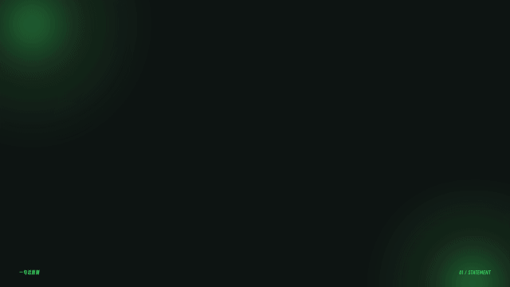 |

### 06 · 三张玻璃说明卡

**适用**：两个或三个并列要点。**状态**：已编码示例；按语义选用。

卡片依次进入，当前讲述的卡片轻微前移。蓝色形状置于玻璃后方，实际产生背景模糊。 最多三卡，中卡更高，侧卡反向倾斜，逐项进入，正在讲的卡轻前移。

**验收**：三卡间距、阴影有层次，小屏字仍可读，不持续晃动。 [交互预览](https://cooperchx.github.io/cooper-video-editing-skill/?scene=6) · [代码](docs/app.js)

| 蓝白 | 黑＋正绿 |
|---|---|
| 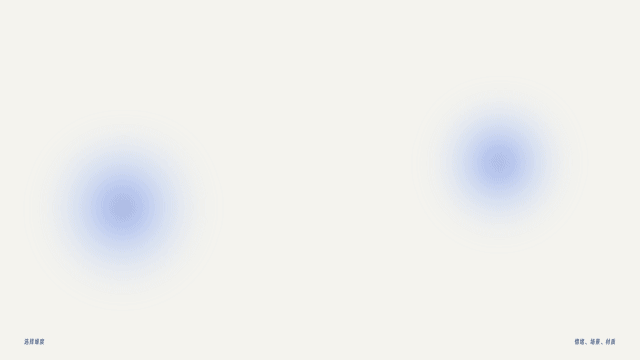 | 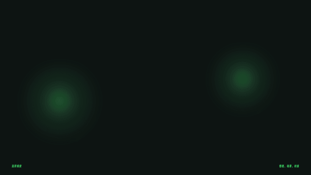 |

### 07 · 标题页

**适用**：主题建立或新章节。**状态**：已编码示例；按语义选用。

先给主题，再出现编辑框与副标题。短片头可以直接接入口播。 左侧大数字/主题，右侧叠卡；扩散柔光替代硬球。

**验收**：不要每条视频重复长片头，信息先于装饰。 [交互预览](https://cooperchx.github.io/cooper-video-editing-skill/?scene=7) · [代码](docs/app.js)

| 蓝白 | 黑＋正绿 |
|---|---|
|  | 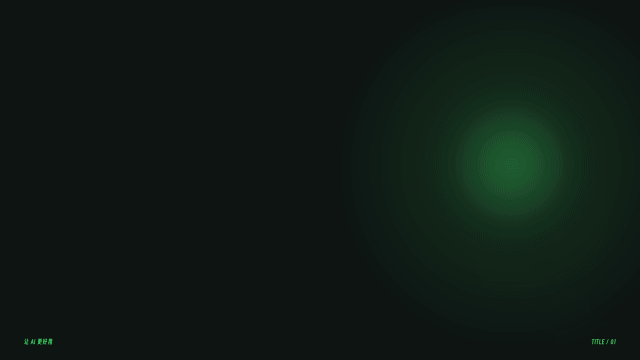 |

### 08 · 羽化椭圆提问页

**适用**：提出一个问题。**状态**：已编码示例；按语义选用。

深蓝中心与蓝色羽化边缘共同出现，字始终位于椭圆视觉中心。 可辨识圆角矩形外容器；内部完整实心渐变椭圆，边缘羽化；文字视觉居中。

**验收**：黑绿版中心不是空洞；没有硬椭圆描边；文字大小适配。 [交互预览](https://cooperchx.github.io/cooper-video-editing-skill/?scene=8) · [代码](docs/app.js)

| 蓝白 | 黑＋正绿 |
|---|---|
|  | 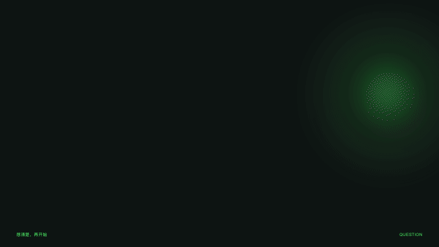 |

### 09 · 数据可视化

**适用**：真实数据支持判断。**状态**：已编码示例；按语义选用。

柱条按比例增长，数值同步更新。强调当前项，数据来源保留在画面下方。 从真实数值映射条长，单位、基线、来源齐全；数值与增长同步。

**验收**：默认 40/60 是示例，不得作为成片证据。 [交互预览](https://cooperchx.github.io/cooper-video-editing-skill/?scene=9) · [代码](docs/app.js)

| 蓝白 | 黑＋正绿 |
|---|---|
| 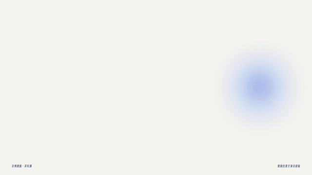 | 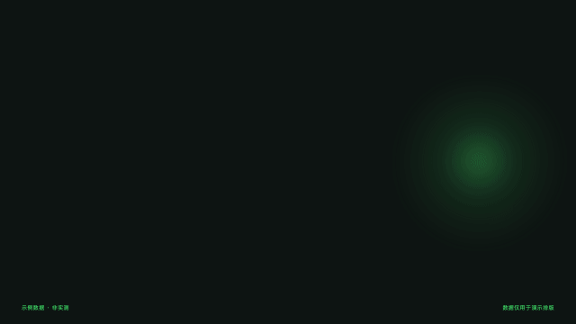 |

### 10 · SVG 步骤流程

**适用**：讲解操作顺序。**状态**：已编码示例；按语义选用。

步骤节点先建立，连线随解释逐段延伸，再把焦点交给下一步。所有形状与线条由 SVG 绘制。 实心蓝色 SVG 图标＋逐段连线，当前节点突出，标签短。

**验收**：节点和连线对齐，避免空心图标；人像如需出现用圆形。 [交互预览](https://cooperchx.github.io/cooper-video-editing-skill/?scene=10) · [代码](docs/app.js)

| 蓝白 | 黑＋正绿 |
|---|---|
|  |  |

### 11 · 录屏焦点放大

**适用**：实际演示软件操作。**状态**：已编码示例；按语义选用。

保留界面全局，用高亮框定位，再将局部引到前景玻璃卡。示例使用代码绘制的匿名界面，不是真实软件录屏。 全局→框定位置→前景局部放大→结果；绑定真实录屏时间坐标。

**验收**：示例是静帧，不冒充真实操作视频；放大不丢失上下文。 [交互预览](https://cooperchx.github.io/cooper-video-editing-skill/?scene=11) · [代码](docs/app.js)

| 蓝白 | 黑＋正绿 |
|---|---|
|  |  |

### 12 · B-roll 素材对照

**适用**：材质、案例需要可见证据。**状态**：已编码示例；按语义选用。

素材先后进入，短标签提示观看重点。这里展示两种代码占位纹理的差异，不将它们标成同内容前后对比。 匹配语义插入真实 B-roll，短标签给观察重点；必要比较才并列。

**验收**：毛线和油画属于不同案例，不能标成同一内容改前/改后。 [交互预览](https://cooperchx.github.io/cooper-video-editing-skill/?scene=12) · [代码](docs/app.js)

| 蓝白 | 黑＋正绿 |
|---|---|
|  |  |

### 13 · 字幕与身份系统

**适用**：整条口播的基础信息。**状态**：已编码示例；按语义选用。

身份条短时出场，字幕按语义替换，关键词保留少量蓝色强调；顶部导航提示当前位置。 原生可编辑字幕；身份条短时出现，章节导航低存在感。

**验收**：语义断句、字音对齐，轻阴影，无生硬大黑块。 [交互预览](https://cooperchx.github.io/cooper-video-editing-skill/?scene=13) · [代码](docs/app.js)

| 蓝白 | 黑＋正绿 |
|---|---|
|  |  |

### 14 · 引用与证据卡

**适用**：引用观点或数据来源。**状态**：已编码示例；按语义选用。

引号与引文先出现，来源随后补齐。来源未确认时明确保留待填状态。 引用正文、来源、日期和必要截图分层；默认待填写保持显著。

**验收**：未核实来源不发布；不是用装饰引号包装自己的结论。 [交互预览](https://cooperchx.github.io/cooper-video-editing-skill/?scene=14) · [代码](docs/app.js)

| 蓝白 | 黑＋正绿 |
|---|---|
| 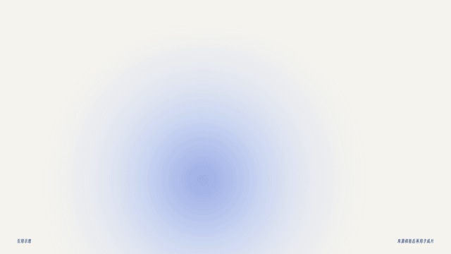 | 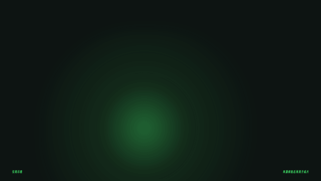 |

### 15 · 章节转场

**适用**：章节发生变化。**状态**：已编码示例；按语义选用。

倾斜卡片从人像右后方进入，靠近镜头后向右上方加速飞出，露出下一章节。 卡从右后方倾斜飞入，再加速向右上飞出，连续露出下一章。

**验收**：两端画面无黑帧，转场不破坏音频剪口。 [交互预览](https://cooperchx.github.io/cooper-video-editing-skill/?scene=15) · [代码](docs/app.js)

| 蓝白 | 黑＋正绿 |
|---|---|
|  | 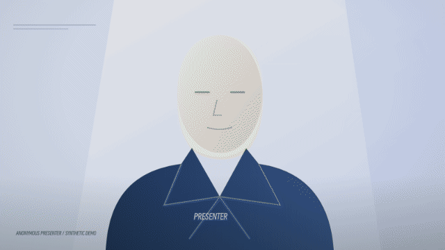 |

### 16 · 结尾总结

**适用**：收束与下一步。**状态**：已编码示例；按语义选用。

逐项回顾核心要点，最后给一条清楚的下一步。 2–3 个要点逐项复现，最后一个行动句。

**验收**：不增加新概念，不堆多个互动指令。 [交互预览](https://cooperchx.github.io/cooper-video-editing-skill/?scene=16) · [代码](docs/app.js)

| 蓝白 | 黑＋正绿 |
|---|---|
| 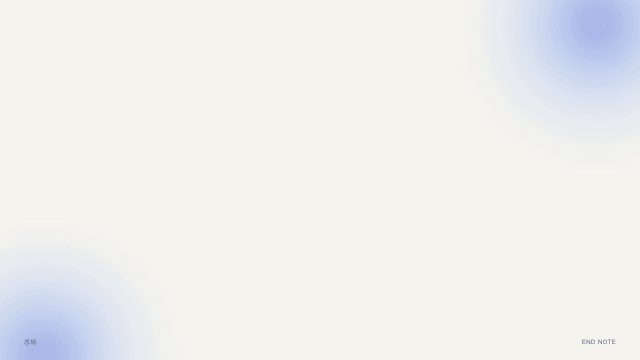 | 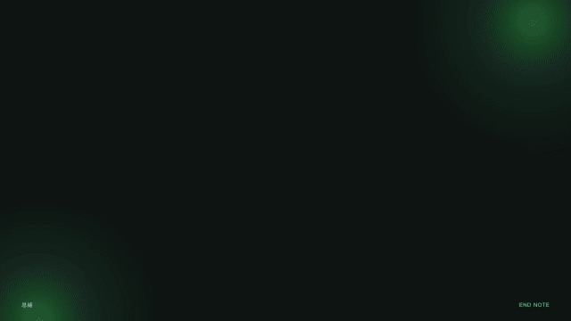 |

### 17 · 鱼眼 · 摩尔纹 · 暗角

**适用**：素材镜头需要短促视觉强调。**状态**：已编码示例；按语义选用。

在真实素材像素上做径向畸变，再叠加摩尔纹与暗角。可用下方入口替换本地素材，文件不会上传。 素材像素径向采样＋轻摩尔纹＋暗角；字幕保持独立清晰。

**验收**：实际畸变，不用缩放冒充；检查边缘采样、摩尔纹闪烁。 [交互预览](https://cooperchx.github.io/cooper-video-editing-skill/?scene=17) · [代码](docs/app.js)

| 蓝白 | 黑＋正绿 |
|---|---|
|  |  |

### 18 · 知识卡片鱼眼巡游

**适用**：连续讲多个知识点。**状态**：已编码示例；按语义选用。

多张知识卡片在空间中巡游；镜头靠近时，当前卡片中心内容产生径向鱼眼形变，向外平滑归零；外框、四周和阴影保持原形。侧边、投影与透视建立厚度。 空间相机依次靠近知识卡。每张卡的中心鱼眼渐强再归零，外框、四周、阴影不变形。

**验收**：蓝白/黑绿均检查 0 与最大强度；文案与财务无关。 [交互预览](https://cooperchx.github.io/cooper-video-editing-skill/?scene=18) · [代码](docs/app.js)

| 蓝白 | 黑＋正绿 |
|---|---|
|  | 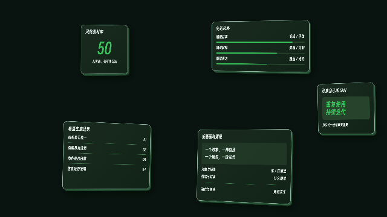 |

### 19 · 圆形人像窗口

**适用**：录屏或信息需要保留更大面积。**状态**：已编码示例；按语义选用。

人物进入圆形窗口，左侧保留完整观点空间。属于探索方案，只在内容结构需要时使用。 圆形人像小窗，边缘轻柔；保留内容空间；不要恢复拱形。

**验收**：保持眼睛和嘴部完整，圆窗不挡关键操作。 [交互预览](https://cooperchx.github.io/cooper-video-editing-skill/?scene=19) · [代码](docs/app.js)

| 蓝白 | 黑＋正绿 |
|---|---|
|  | 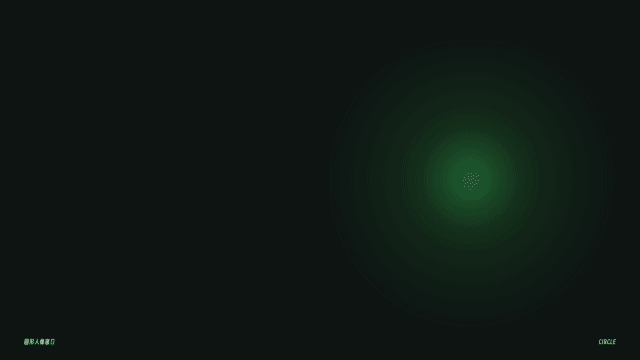 |

### 20 · 叠层纸卡

**适用**：单观点需要纸张层次。**状态**：探索备选。

两张纸卡错位落下，前卡承载观点，后卡保留少量线索。 前卡承载唯一重点，后卡错位只保留线索。

**验收**：探索备选，不默认替换已认可的人后卡。 [交互预览](https://cooperchx.github.io/cooper-video-editing-skill/?scene=20) · [代码](docs/app.js)

| 蓝白 | 黑＋正绿 |
|---|---|
|  | 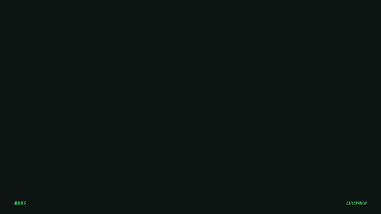 |

### 21 · 切角信息卡

**适用**：一个动作或提醒。**状态**：探索备选。

切角蓝卡搭配短标题和编号。适合一个明确动作或单项提醒。 切角纯色卡＋编号＋短标题，简洁落位。

**验收**：探索备选；切角不挤占可读区域。 [交互预览](https://cooperchx.github.io/cooper-video-editing-skill/?scene=21) · [代码](docs/app.js)

| 蓝白 | 黑＋正绿 |
|---|---|
|  | 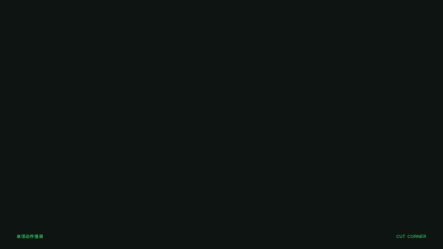 |

### 22 · SVG 轨道关系图

**适用**：表达中心与因素的关系。**状态**：探索备选。

中心判断固定，三个节点沿各自的弧线进入后稳定。轨道表示关系，不持续旋转干扰阅读。 中心固定，节点沿弧线依次出现后稳定。

**验收**：探索备选；没有持续绕圈、无意义环绕。 [交互预览](https://cooperchx.github.io/cooper-video-editing-skill/?scene=22) · [代码](docs/app.js)

| 蓝白 | 黑＋正绿 |
|---|---|
| 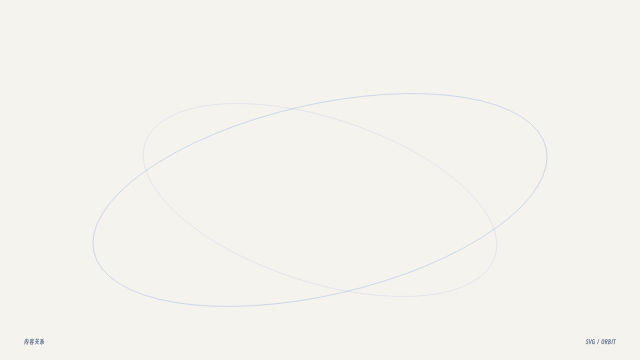 | 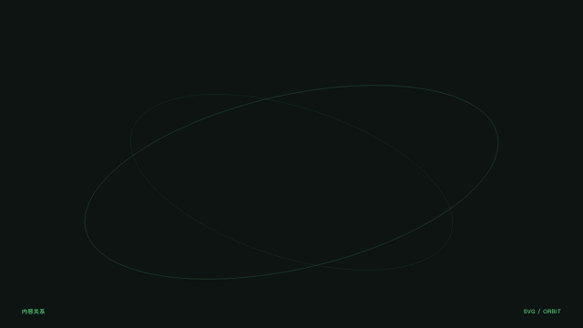 |

### 23 · 立体贴纸花字

**适用**：短词需要少量重量感。**状态**：探索备选。

通过挤出字影、轻微透视和短促落位建立厚度。只用于短词，控制使用频率。 克制挤出字影、轻透视、短促落位。

**验收**：探索备选；低频使用，不做大面积闪烁或弹跳。 [交互预览](https://cooperchx.github.io/cooper-video-editing-skill/?scene=23) · [代码](docs/app.js)

| 蓝白 | 黑＋正绿 |
|---|---|
|  | 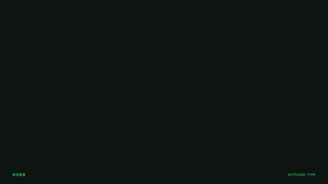 |

### 24 · 人后羽化提问卡

**适用**：人物讲出一个问题。**状态**：已编码示例；按语义选用。

将认可的羽化椭圆放回米白卡片，插入人物与背景之间。与全屏提问页共享同一视觉语言。 08 的羽化椭圆放在米白卡里，插入人像和背景之间；白卡外缘也轻羽化。

**验收**：仍看得出圆角矩形；字正中，遮挡与动态蒙版一致。 [交互预览](https://cooperchx.github.io/cooper-video-editing-skill/?scene=24) · [代码](docs/app.js)

| 蓝白 | 黑＋正绿 |
|---|---|
|  |  |

### 25 · 液体百分比

**适用**：明确百分比或完成占比。**状态**：已编码示例；按语义选用。

透明圆形容器中的液面上升，双层波纹与少量浮动气泡表现液体。数字跟随液面同步变化。 圆形容器按填充面积反解液面高度，双波纹、少量气泡，数字同步。

**验收**：72% 只是示例；不是把百分比直接当圆内线性高度。 [交互预览](https://cooperchx.github.io/cooper-video-editing-skill/?scene=25) · [代码](docs/app.js)

| 蓝白 | 黑＋正绿 |
|---|---|
| 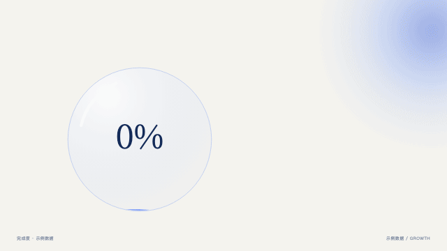 | 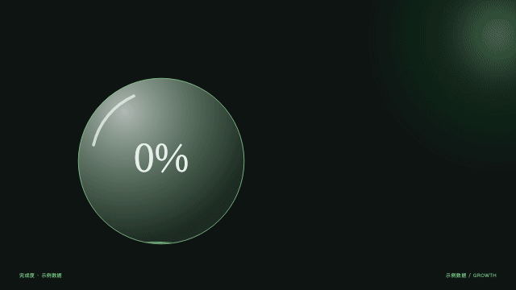 |

### 26 · 环形进度

**适用**：阶段进度。**状态**：已编码示例；按语义选用。

环形轨迹按比例生长，端点与数字同步；达到目标后轻微回响并停留。 圆弧长度＝比例×周长，端点和数字同步，落位后停留。

**验收**：78% 是示例；起点方向、终点和数值一致。 [交互预览](https://cooperchx.github.io/cooper-video-editing-skill/?scene=26) · [代码](docs/app.js)

| 蓝白 | 黑＋正绿 |
|---|---|
| 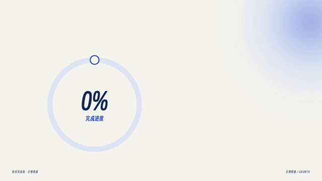 | 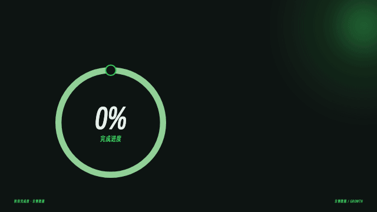 |

### 27 · 数字翻牌增长

**适用**：真实累计数量。**状态**：已编码示例；按语义选用。

数字滚动到目标值，进度刻度随后填充。适合数量、里程碑与累计成果。 数字翻牌滚动至目标，刻度补齐，终值稳定。

**验收**：50 是示例；不夸大数字、不越过真实目标。 [交互预览](https://cooperchx.github.io/cooper-video-editing-skill/?scene=27) · [代码](docs/app.js)

| 蓝白 | 黑＋正绿 |
|---|---|
|  | 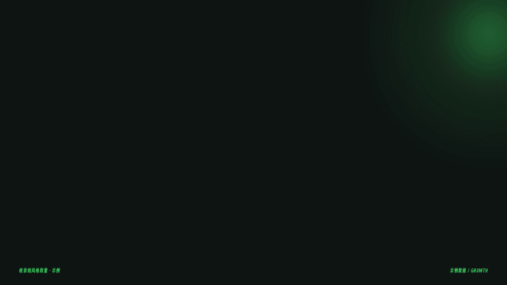 |

### 28 · 趋势曲线生长

**适用**：随时间发生的变化。**状态**：已编码示例；按语义选用。

曲线沿时间方向逐段延伸，面积随路径显现，当前位置与数值同步跟随。 按实际坐标生成路径，沿时间生长，面积和当前位置同步。

**验收**：示例曲线不是实测；真实使用必须明确横轴时间、纵轴单位、来源。 [交互预览](https://cooperchx.github.io/cooper-video-editing-skill/?scene=28) · [代码](docs/app.js)

| 蓝白 | 黑＋正绿 |
|---|---|
| 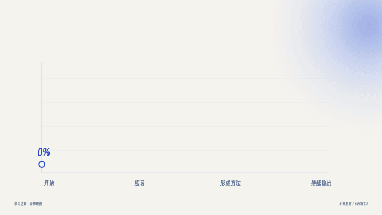 | 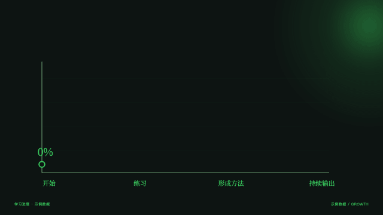 |

### 29 · 阶梯里程碑

**适用**：流程或成长阶段。**状态**：已编码示例；按语义选用。

阶梯依次长高，每到一站出现一个动作。适合解释流程推进和能力成长。 四阶按语义依次长出，动作词随阶段出现。

**验收**：不是无来源的量化增幅，不把不同阶段高度当统计。 [交互预览](https://cooperchx.github.io/cooper-video-editing-skill/?scene=29) · [代码](docs/app.js)

| 蓝白 | 黑＋正绿 |
|---|---|
|  | 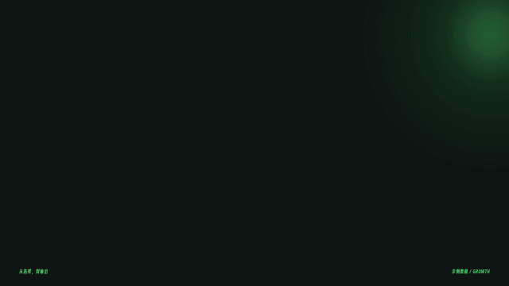 |

### 30 · 积木聚合增长

**适用**：零散积累形成系统。**状态**：已编码示例；按语义选用。

独立模块逐批汇入网格，最后形成完整体系。适合素材库、知识库与能力积累。 单元逐批汇入网格，聚合计数与已落位模块一致，最后稳定。

**验收**：随机性需固定种子；任意跳帧得到相同模块位置。 [交互预览](https://cooperchx.github.io/cooper-video-editing-skill/?scene=30) · [代码](docs/app.js)

| 蓝白 | 黑＋正绿 |
|---|---|
|  | 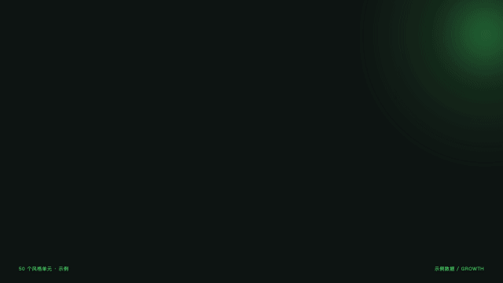 |

## 详细规则与交付状态

- [口播精剪、字幕、镜头、素材、声音与阅读节奏](references/editorial.md)
- [视觉系统、主题、形状材质与候选方向](references/visual-system.md)
- [字体来源、样张、授权与替代边界](references/typography.md)
- [代码运行、参数接口、Remotion / ChatCut 适配](references/runtimes.md)
- [验证记录与实际能力边界](references/validation.md)
- [组件数据](assets/components.json) · [设计参数](assets/tokens.json) · [许可与素材范围](NOTICE.md)

本版包含 30 个浏览器场景、60 个双主题动效 GIF、1 个得意黑字体 GIF。匿名人物、虚构界面与代码纹理用于展示版式；连续口播、动态抠像、音轨与最终 MP4 仍需接入项目。新增的三类候选效果尚未实现，不算在 30 项之内。
